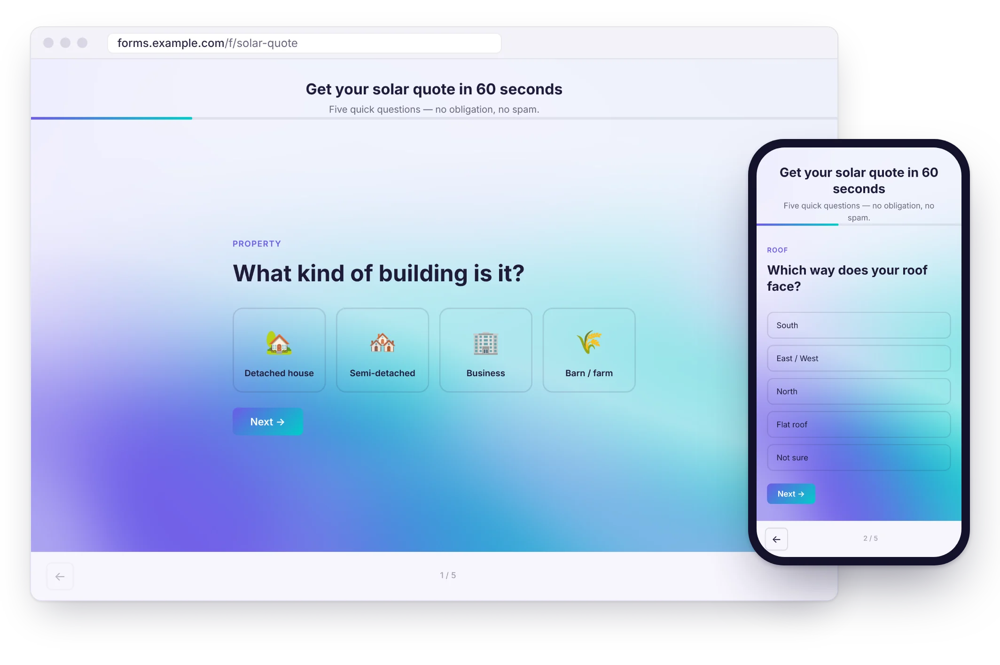
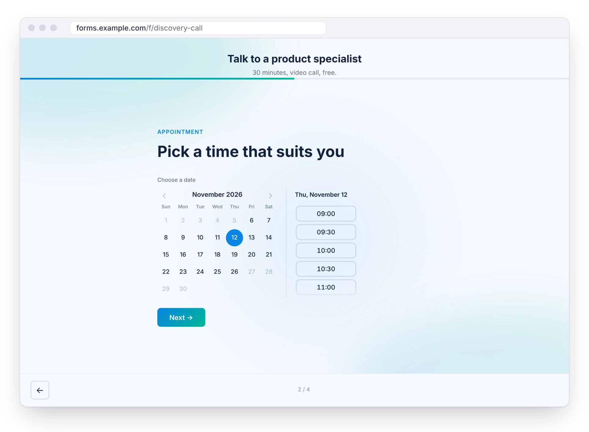
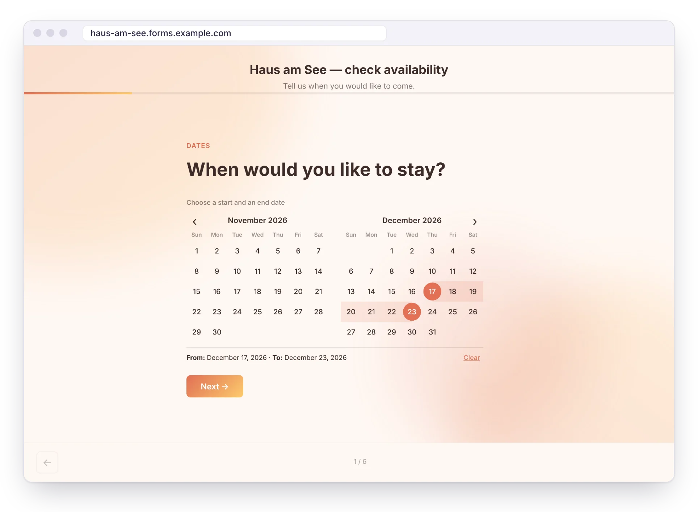
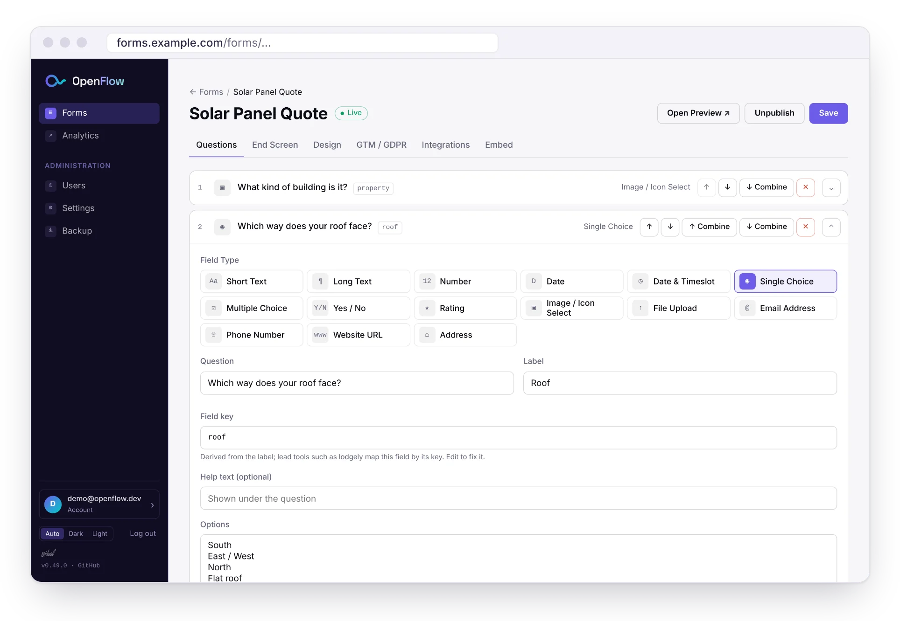
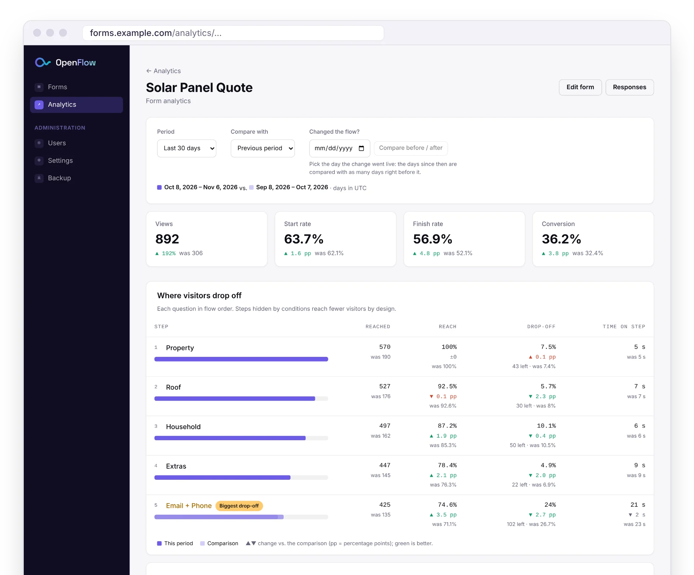
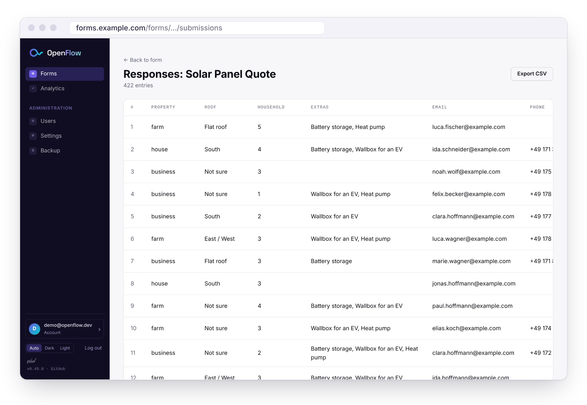
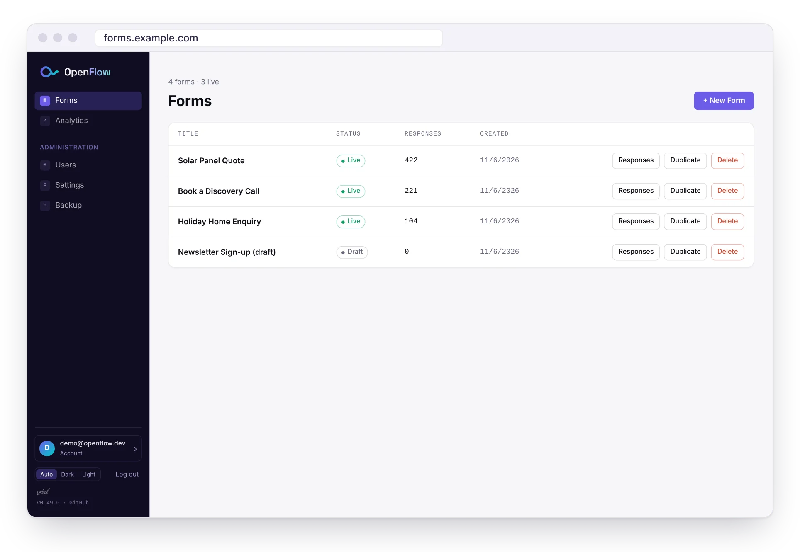

<p align="center">
  <a href="https://github.com/vidual-labs/openflow">
    <picture>
      <source media="(prefers-color-scheme: dark)" srcset="docs/assets/openflow-logo-dark.svg">
      
    </picture>
  </a>
</p>

<p align="center">
  <strong>Open-source form builder for lead generation.</strong><br>
  A self-hosted alternative to Typeform and Heyflow.
</p>

<p align="center">
  <a href="https://github.com/vidual-labs/openflow/releases"></a>
  <a href="LICENSE"></a>
  <a href="https://github.com/vidual-labs/openflow/actions/workflows/ci.yml"></a>
  <a href="https://github.com/vidual-labs/openflow/pkgs/container/openflow"></a>
  <a href="https://github.com/vidual-labs/openflow/stargazers"></a>
</p>

<p align="center">
  
</p>

<p align="center">
  <a href="#-features">Features</a> ·
  <a href="#-screenshots">Screenshots</a> ·
  <a href="#-works-with-lodgely-and-calon">lodgely &amp; calon</a> ·
  <a href="#-quick-start">Quick start</a> ·
  <a href="docs/README.md">Docs</a> ·
  <a href="ROADMAP.md">Roadmap</a>
</p>

Multi-step lead forms, one question per screen, on your own server. One Docker
container, a SQLite file, no per-response pricing, and no tracking you didn't add.

## ✨ Features


- **15 field types**: text, choice, image/icon select, number stepper, date ranges, a Date & Timeslot picker, file upload, address and more
- **Logic**: show or hide steps based on earlier answers, two questions on one screen, budget options filtered by an earlier answer
- **Design per form**: colours, fonts, five animated backgrounds, a landing-page header, custom CSS, EN/DE strings
- **Integrations**: signed webhooks, e-mail, Google Sheets, Google Ads offline conversions, Meta Conversions API. Failed deliveries are retried
- **Analytics**: views → starts → completions, drop-off and time per step, compared with an earlier period
- **Embed anywhere**: iframe with auto-resize, a WordPress plugin, custom slugs, per-form subdomains, GTM behind a cookie banner
- **Secure defaults**: server-side sessions, opt-in e-mailed 2FA, account lockout, password re-entry for sensitive actions, encrypted write-only secrets
- **Operations**: multiple users, read-only API tokens, scheduled backups, an audit log, a health check

<br clear="right">

→ **[The full feature list](docs/features.md)**

## 📸 Screenshots

**What visitors see.** A booking form with its own time slots, and a holiday-home enquiry on its own subdomain:

<table>
  <tr>
    <td width="50%" valign="top"></td>
    <td width="50%" valign="top"></td>
  </tr>
</table>

**What you work in.** The form editor: question cards, the field type picker and a stable key per field:

<p align="center"></p>

Per-form analytics: where visitors drop off, compared with the previous period:

<p align="center"></p>

<details>
<summary><strong>More: responses and the form list</strong></summary>
<br>
<table>
  <tr>
    <td width="50%" valign="top"></td>
    <td width="50%" valign="top"></td>
  </tr>
</table>
</details>

<sub>All data in the screenshots is made up.</sub>

## 🔗 Works with lodgely and calon

<p align="center">
  
</p>

OpenFlow runs fine on its own. Two optional self-hosted companions add to it:

- **[calon](https://github.com/vidual-labs/calon)** turns a Date & Timeslot field into real booking. The form shows calon's conflict-checked availability, and the picked slot is booked before the lead is stored. If calon's resource is connected to Google Calendar or Microsoft 365, the booking also lands in that calendar. → [Setup](docs/integrations/calon.md)
- **[lodgely](https://github.com/vidual-labs/lodgely)** is a lead intake hub. It pulls each form's submissions with a read-only API token and maps them onto its lead fields by their stable field keys. → [Setup](docs/integrations/lodgely.md)

## 🚀 Quick start

```bash
git clone https://github.com/vidual-labs/openflow.git
cd openflow
docker compose pull
docker compose up -d
```

Open `http://localhost:3000` and sign in as `admin@openflow.local`. On first start
OpenFlow generates a one-time password and prints it once to the log
(`docker compose logs app`). It never ships a default password.

To update, run `git pull && docker compose pull && docker compose up -d`. Your data
stays in the `db-data` volume. For environment variables, TLS and reverse proxies, see
[configuration](docs/configuration.md) and [security & production](docs/production.md).

## 📚 Documentation

| Page | What's in it |
|------|--------------|
| [Features](docs/features.md) | Every feature, field type and analytics metric |
| [Installation & configuration](docs/configuration.md) | Install, update, all environment variables |
| [Integrations](docs/integrations/README.md) | Webhook, e-mail, Sheets, Google Ads, Meta, [lodgely](docs/integrations/lodgely.md), [calon](docs/integrations/calon.md) |
| [Embedding & tracking](docs/embedding.md) | iframe, WordPress, slugs, GTM events, cookie banner |
| [Custom subdomains](docs/subdomains.md) | A subdomain per form behind one wildcard certificate |
| [API endpoints](docs/api.md) | Routes, auth and read-only API tokens |
| [Security & production](docs/production.md) | Secure defaults, proxies, backups, known gaps |
| [Development](docs/development.md) | Running from source, tests, repository layout |

## 🗺️ Roadmap

Planned next: a versioned submission contract and signed webhook for lodgely,
answer-based routing, hidden fields and UTM capture, spam protection, partial
submissions, and GDPR retention and erasure. Details in **[ROADMAP.md](ROADMAP.md)**.

## Ethical use

OpenFlow is a marketing tool. As a non-binding request, please don't use it for
clients in weapons and armaments, fossil-fuel energy (extraction, refining,
distribution, generation), or internal-combustion passenger vehicles (electric vehicles, bicycles and public transit are fine). This
is a request from the maintainers, not a legal restriction. See the preamble in
[LICENSE](LICENSE).

## 📄 License

GPL 3.0, see [LICENSE](LICENSE).
