[← README](../../README.md) · [All docs](../README.md)

# Integrations

Configure integrations per form in the **Integrations** tab of the form editor.

## 🔗 Webhook
Send submission data to any URL on each submission.
- Configurable HTTP method (POST/PUT)
- JSON payload: `event` (always `"submission"`), `formId`, `formTitle`, `data` (keyed by field id), `timestamp` (ISO 8601)
- Optional HMAC-SHA256 signing with a shared secret, sent as an `X-OpenFlow-Signature` header — the signature is computed over the exact JSON bytes sent as the body, so a receiver can verify it by HMAC-ing the raw request body it received
- The target URL is checked against private/internal address ranges before the request is made, and redirects are not followed

## 📧 Email Notification
Receive an email with a formatted HTML table of each submission.
- Full SMTP configuration (host, port, user, password, TLS)
- Customizable sender, recipient, and subject line

## 📊 Google Sheets (Simple)
Auto-append submissions via Google Apps Script — **no JSON key needed**.
1. Open your Google Sheet → Extensions → Apps Script
2. Paste the provided script, deploy as Web App
3. Copy the URL into OpenFlow

## 📊 Google Sheets (Service Account)
Auto-append each submission using a Google Service Account.
- Auto-creates header row from form field labels
- Configurable sheet name

## 🎯 Google Ads (Server-Side Conversion)
Upload qualifying leads as offline conversions directly to Google Ads, via the
[Data Manager API](https://developers.google.com/data-manager/api) — no
browser-side conversion pixel required.
- OpenFlow captures `gclid`/`gbraid`/`wbraid` from the form's landing URL
  (subject to the same cookie-consent setting used for GTM); submissions
  without one of these click IDs are skipped, since there's nothing to
  attribute them to
- Requires a one-time setup outside OpenFlow: an OAuth client + refresh token
  for a Google account with access to your Google Ads account (client ID,
  client secret, refresh token, customer ID, conversion action ID — pasted
  into the integration config, same as the Google Sheets service-account flow)
- No developer token needed — the Data Manager API uses plain OAuth2
- Optionally map one of the form's fields as the conversion value, or set a
  fixed default value
- The **Test** button only validates the OAuth credentials — it does not
  upload a real conversion, since a test submission has no genuine click ID
- See [`google-ads.md`](google-ads.md) for the full one-time setup walkthrough

## 📣 Meta Conversions API
Send a server-side `Lead` event to Facebook/Instagram Ads on every
submission, via [Meta's Conversions API](https://developers.facebook.com/docs/marketing-api/conversions-api) —
no Meta Pixel needs to be installed on the form.
- Matching relies on the submission's captured IP address and user agent,
  plus SHA-256-hashed `Email`/`Phone` field values when the form collects
  them (matched by field **type**, not id), and — once cookie consent allows
  it — the ad click ID (`?fbclid=` → `fbc`) and any Meta Pixel `_fbp`/`_fbc`
  cookies
- Every event carries the submission id as `event_id`; the same id is
  pushed to the dataLayer (`openflow_submit` → `eventId`) and posted to the
  embedding page, so a Meta Pixel `Lead` using it as `eventID` is
  deduplicated against the server-side event
- Click IDs are captured on the form's direct link (`/f/<slug>` or its
  subdomain). An embedded form can't read the host page's URL, so an
  `fbclid` there doesn't reach OpenFlow (the same applies to `gclid`)
- Requires a Pixel ID and an access token, both generated in Events Manager
  → Data Sources → your Pixel → Settings → Conversions API
- Optionally map one of the form's fields as the event value, or set a
  fixed default value
- An optional **Test Event Code** routes events into Events Manager's Test
  Events tool instead of counting them as real leads; the **Test** button
  only sends a real event while one is set — otherwise it just validates
  the Pixel ID/access token, since a test submission has no genuine lead
- See [`meta-conversion-api.md`](meta-conversion-api.md) for the full setup walkthrough

> 💡 Each integration has an **Enable/Disable** toggle and a **Test** button to verify your setup with sample data.

## 🏨 lodgely and 📅 calon

Two companion apps plug into OpenFlow without any push configuration:

- **[lodgely](lodgely.md)** pulls finished leads out of OpenFlow with a read-only API token.
- **[calon](calon.md)** gives a Date & Timeslot field real availability and books the picked slot, optionally straight into Google Calendar or Microsoft 365.
