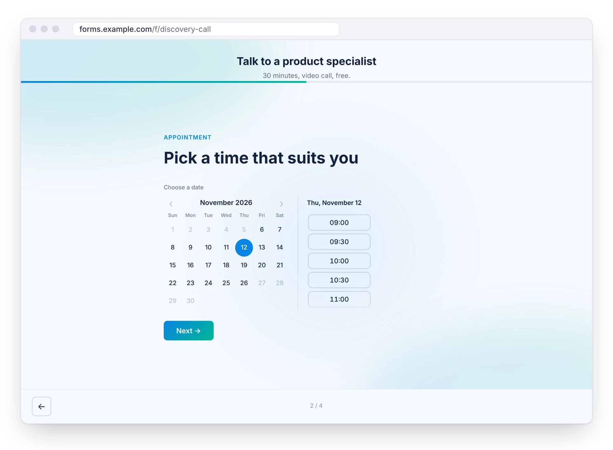

[← README](../../README.md) · [All docs](../README.md) · [Integrations](README.md)

# 📅 calon (real-time booking + calendar sync)

[calon](https://github.com/vidual-labs/calon) — a self-hosted, single-container
booking engine — is wired into OpenFlow **directly**: a Date & Timeslot field is
pointed at a calon instance and talks to it through OpenFlow's own backend. No
webhook, no shared secret and no config on the calon side are needed — just the
calon URL in the field.

> **Requirements — read this first.**
>
> - **Two separate deployments.** calon is its own application and must be
>   deployed separately, at a URL **OpenFlow's server can reach**. Like every
>   URL OpenFlow fetches, it has to resolve to a **public** address unless you
>   opt the host in: for a calon on the same Docker network or LAN (e.g.
>   `http://calon:8000`), set `CALON_ALLOWED_HOSTS=calon:8000` (see
>   [Configuration](../configuration.md#️-environment-variables)). Without it, **Test connection** answers
>   "Requests to localhost are not allowed" or "…resolves to a private/internal
>   address".
> - **The calendar write is done by calon, never by OpenFlow.** OpenFlow only
>   sends the chosen slot to calon. calon reads the connected calendar's
>   free/busy and **writes accepted bookings into Google Calendar or Microsoft
>   365**. OpenFlow holds no calendar credentials and never calls Google or
>   Microsoft.

Once connected (field editor → **Connect to calon**), OpenFlow:

- **Shows real availability** — the field renders the slots calon reports as free
  for that calendar (calon's scheduling rules and any connected calendar's busy
  time decide which). **Test connection** checks the link before you publish.
- **Books the picked slot on submit** — before the submission is stored, OpenFlow
  books the slot in calon under the respondent's name, email and phone. Which
  fields those are is picked under **Book under** in the same panel (automatic by
  default: the first Email and Phone fields, and a Short Text field with the
  *Full name* autofill). calon needs an email, so the form needs an Email field.
- **Books exactly the slot that was shown** — the field's **Slot length** is the
  length OpenFlow asks calon's availability for, and the booking carries the
  matching end time, so calon books that length rather than its own default.
- **Sends the respondent back if the slot is gone** — when calon turns the slot
  down (taken in the meantime, or against its rules), the respondent lands back on
  the Date & Timeslot step with fresh times and a note to pick another; nothing is
  stored until the booking succeeds.
- **Never loses a lead to a calon outage** — if calon can't be reached at submit,
  the submission is stored anyway and the booking is retried in the background
  (1, 5, 30, 120, 360 minutes). A request calon refuses outright rather than the
  slot (it answers `400`/`422`, or the resource is unknown — usually a
  configuration problem) also keeps the submission, with the booking marked
  `failed` and calon's reason in `lastError`. The outcome is kept in the
  submission's metadata (`calonBookings`: `booked` with calon's booking id,
  `pending`, `rejected` or `failed`).

## How the two sides talk

| Direction | Mechanism | What it does |
|-----------|-----------|--------------|
| OpenFlow → calon (availability) | `GET /api/v1/availability`, fetched **server-side** by OpenFlow | Returns which slots are free for the field's resource in the window; OpenFlow hands the list to its own frontend. Public and unauthenticated by design. |
| OpenFlow → calon (booking) | `POST /api/v1/bookings`, sent **server-side** by OpenFlow on submit | calon's public booking endpoint — the same one its own booking form uses. calon judges the request (conflicts, buffers, blackouts, connected calendar) and answers `201` (booked) or `200` with the reason it was rejected. |

Both calls go through the same SSRF guard as every other operator-supplied URL, and
neither needs CORS: OpenFlow's backend is the caller, never the browser.

## Calendar sync (Google & Microsoft 365)

The calendar write is **calon's job**. To land bookings in a real calendar, connect the
calon resource's calendar in **calon's dashboard** (Calendars → Connect) — see the
["Resource calendar sync" section of calon's self-hosting
guide](https://github.com/vidual-labs/calon/blob/main/docs/self-hosting.md). calon then
hides slots that are busy on that calendar and writes each accepted booking into it.
Without a connected calendar, bookings still land in calon (its dashboard, `.ics` and
calendar links).
