[← README](../../README.md) · [All docs](../README.md) · [Integrations](README.md)

# 🏨 lodgely (lead intake hub)

[lodgely](https://github.com/vidual-labs/lodgely) — a self-hosted lead intake
hub — can **pull** a form's submissions into a specific client view. Unlike the
push integrations above, this is configured entirely in lodgely (under
**Imports → OpenFlow**), so there is nothing to set up on the OpenFlow side
beyond an account that owns the form:

- **Recommended:** create a **read-only API token** under **Account → API
  Tokens** (OpenFlow asks for your password first) and paste it into lodgely. The token can read what its owner can
  read (their forms and submissions) but never modify anything, never manage
  tokens, and never reach admin endpoints (backups, users, audit log) — even
  when an admin created it. Revoke it anytime without touching your password.
  Creating it from a dedicated non-admin account that owns only the forms
  lodgely needs keeps its reach smallest.
- Alternatively, lodgely can sign in with an OpenFlow login (email + password).
- It maps each OpenFlow field to a lead field; unmapped answers are kept as
  custom answers. Re-fetches are idempotent on the submission id.
- Every field has a stable, readable **key** (`email`, `vorname`, `budget_2`;
  shown on the question card and editable under **Field key** in the editor).
  Keys are what lodgely maps on, so keep them stable once leads are flowing —
  the key follows the label until you edit it.
- Point lodgely at your OpenFlow base URL and pick the form — leads flow into
  the chosen client automatically.
